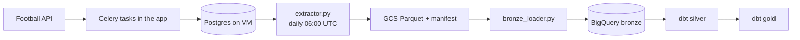

# Pitchside Data Platform

An analytics-engineering project built on the data behind [Pitchside](https://github.com/skt0909/EXP), a full-stack fantasy football app (FastAPI, PostgreSQL, React, XGBoost). It copies the app's data into a cloud warehouse and models it with dbt.

**Project site:** https://skt0909.github.io/pitchside-data-platform/ (snapshot of the data as of 2026-11-03)

> **Status:** repo layout and secrets are set up (Stage 1). The extractor and Bronze loader are in `ingestion/vm/`. The dbt project in `pitchside_dbt/` comes from an earlier version and has not been changed yet.

## Architecture



Full notes live in [knowledge/](knowledge/README.md).

## Repo layout

| Path | What it holds |
| --- | --- |
| `ingestion/vm/` | `extractor.py` (Postgres to GCS) and `bronze_loader.py` (GCS to BigQuery bronze) |
| `pitchside_dbt/` | dbt project (staging views, mart tables, tests) |
| `knowledge/` | architecture, security model, decisions, runbook, glossary |
| `requirements-vm.txt` | packages for the two VM scripts |
| `requirements-dbt.txt` | packages for dbt and analysis |

## Secrets

No key files and no passwords in git. The VM impersonates a service account instead of using a key, and the database password lives only on the VM. See [knowledge/04-security-model.md](knowledge/04-security-model.md).

## Run it

```bash
# On the VM
pip install -r requirements-vm.txt
python ingestion/vm/extractor.py        # SKIP_GATE=1 to skip the heartbeat gate when testing
python ingestion/vm/bronze_loader.py

# dbt (off the VM)
pip install -r requirements-dbt.txt
cd pitchside_dbt
dbt run
dbt test
```

More commands are in [knowledge/09-runbook.md](knowledge/09-runbook.md).

## Related

- [Pitchside](https://github.com/skt0909/EXP): the application this data comes from.
